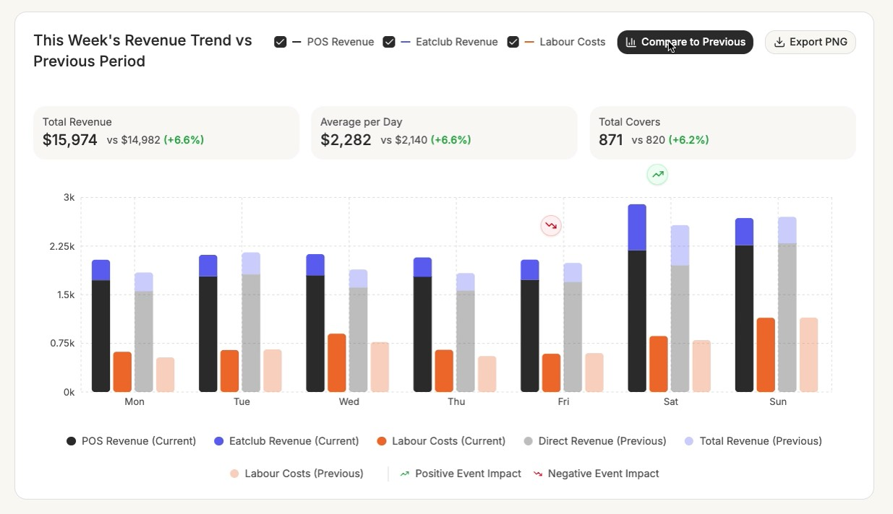
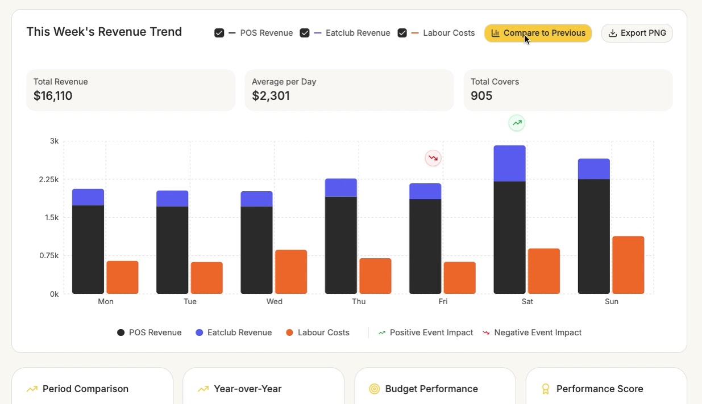
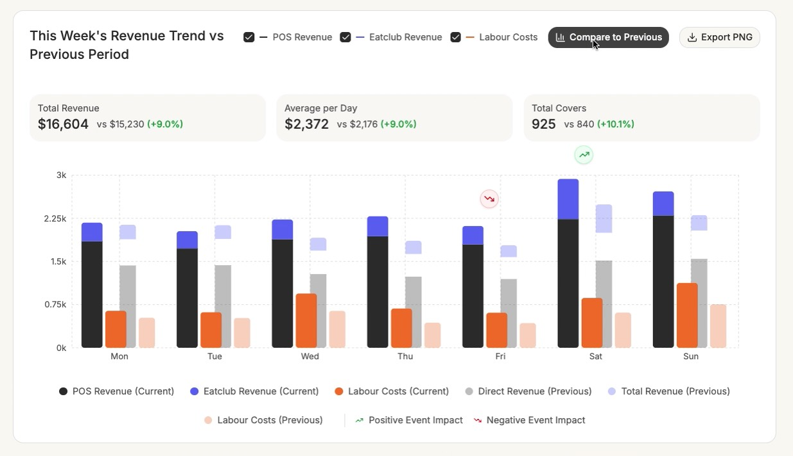

# User Stories & Task Detail — Revenue Trend Dashboard

> Nguồn: `yeu-cau.md` + video `b50d5bc7-fb4e-46c3-9f6c-739032b8a559.mp4` (12s).
> Ảnh tham chiếu UI: [docs/ui-reference/](ui-reference/)
> Stack: **Backend** Node.js · **Front** Next.js · **DB** PostgreSQL

---

## 0. Phân tích UI từ video

### 0.1 Tổng quan
Một card dashboard "**This Week's Revenue Trend**" hiển thị doanh thu 7 ngày (Mon → Sun) dạng **bar chart chồng (stacked)**, có chế độ **so sánh với kỳ trước** (Compare to Previous). Video chủ yếu thao tác bật/tắt nút *Compare to Previous*; khi chuyển chế độ, cột có **animation** mọc lên.

| Ảnh | Trạng thái |
|---|---|
|  | Compare **ON** |
|  | Compare **OFF** |
|  | Đang animate khi chuyển chế độ |

### 0.2 Thành phần

**A. Header**
- Title: Compare OFF → `This Week's Revenue Trend`; Compare ON → `This Week's Revenue Trend vs Previous Period` (xuống 2 dòng).
- 3 checkbox bật/tắt series: `☑ — POS Revenue` (gạch đen), `☑ — Eatclub Revenue` (gạch xanh tím), `☑ — Labour Costs` (gạch cam).
- Nút **Compare to Previous** (icon bar-chart): ON = nền đen chữ trắng; OFF = nền vàng (`#FAC841`, hover đậm hơn `#D2AC3D`).
- Nút **Export PNG** (icon download, viền xám, nền trắng) → tải ảnh của card.

**B. 3 KPI card** (nền `#F6F5F3`, bo góc)
| Card | Giá trị | Khi Compare ON |
|---|---|---|
| Total Revenue | `$15,974` = Σ(POS + Eatclub) 7 ngày | `vs $14,982 (+6.6%)` |
| Average per Day | `$2,282` = Total / 7 | `vs $2,140 (+6.6%)` |
| Total Covers | `871` = Σ covers | `vs 820 (+6.2%)` |
- % thay đổi: xanh lá nếu ≥ 0 (`+x.x%`), đỏ nếu < 0. Làm tròn 1 chữ số thập phân. Tiền format `$` + phân cách hàng nghìn, không số lẻ.

**C. Chart**
- Trục Y: `0k, 0.75k, 1.5k, 2.25k, 3k` (4 khoảng đều, format `k`), lưới nét đứt xám nhạt; trục X: `Mon … Sun`.
- Mỗi ngày gồm các cột (bo góc trên):

| Cột | Compare OFF | Compare ON |
|---|---|---|
| 1. Revenue hiện tại (stack: POS đen dưới + Eatclub tím trên) | ✔ | ✔ |
| 2. Labour Costs hiện tại (cam) | ✔ | ✔ |
| 3. Revenue kỳ trước (stack: Direct/POS xám dưới + Eatclub tím nhạt trên) | — | ✔ |
| 4. Labour Costs kỳ trước (cam nhạt) | — | ✔ |

- **Event marker**: icon tròn phía trên nhóm cột của ngày có sự kiện — xanh lá (trending-up) = *Positive Event Impact*, đỏ (trending-down) = *Negative Event Impact*. Video: Fri = negative, Sat = positive.
- Animation khi đổi dữ liệu/chế độ (cột mọc từ đáy).

**D. Legend (dưới chart)**
- OFF: `● POS Revenue  ● Eatclub Revenue  ● Labour Costs | ↗ Positive Event Impact  ↘ Negative Event Impact`
- ON: `● POS Revenue (Current)  ● Eatclub Revenue (Current)  ● Labour Costs (Current)  ● Direct Revenue (Previous)  ● Total Revenue (Previous)  ● Labour Costs (Previous) | ↗ Positive…  ↘ Negative…`

**E. Bên dưới card** (chỉ thấy phần đầu ở trạng thái OFF): 4 card `Period Comparison`, `Year-over-Year`, `Budget Performance`, `Performance Score` → **không làm** (xem §6).

### 0.3 Design tokens (đo từ video)
| Token | Màu |
|---|---|
| page background | `#F8F7F2` |
| card background | `#FFFFFF` (border xám rất nhạt, radius ~16px) |
| KPI background | `#F6F5F3` |
| POS (current) | `#2A2A2A` |
| Eatclub (current) | `#595BEE` |
| Labour (current) | `#EC6629` |
| Direct/POS (previous) | `#BDBDBD` |
| Eatclub (previous) | `#CACCFC` |
| Labour (previous) | `#F8CFBD` |
| Button active | `#2B2B2B` |
| Button compare off | `#FAC841` / hover `#D2AC3D` |
| Positive event | icon `#22A35A`, nền `#EAFBF1` |
| Negative event | icon `#D23B4A`, nền `#FDF3F4` |
| Font | Inter (sans-serif) |

---

## 1. Kiến trúc đề xuất

```
project-job/
├── apps/
│   ├── api/        # Node.js + Express + TypeScript + Prisma  (port 4000)
│   └── web/        # Next.js (App Router) + Tailwind           (port 3000)
│       ├── /                → Dashboard (public view)
│       └── /admin/*         → Admin (login + CRUD data)
├── docker-compose.yml        # Postgres (tuỳ chọn)
├── docs/
└── README.md
```

- **Front + Front-admin** chung 1 app Next.js, admin nằm dưới route group `/admin` được bảo vệ bằng middleware → đơn giản khi cài đặt local. (Có thể tách thành `apps/admin` nếu muốn.)
- **Backend** riêng (`apps/api`) cung cấp REST API cho cả view và admin.
- **ORM/Migration**: Prisma (`prisma migrate` + `prisma db seed`).
- **Chart**: Recharts (hỗ trợ stacked bar `stackId`, animation sẵn). **Export PNG**: `html-to-image`.
- **Auth**: email + password (bcrypt), JWT lưu trong **httpOnly cookie**; admin mặc định được tạo bằng seed từ biến môi trường.
- Package manager: pnpm workspaces (hoặc npm workspaces).

### 1.1 Data model

```
admin_users
  id            uuid PK
  email         varchar unique
  password_hash varchar
  name          varchar
  created_at, updated_at

daily_metrics                      -- 1 dòng / ngày
  id               uuid PK
  date             date UNIQUE
  pos_revenue      numeric(12,2) >= 0
  eatclub_revenue  numeric(12,2) >= 0
  labour_cost      numeric(12,2) >= 0
  covers           int >= 0
  created_at, updated_at

event_impacts                      -- sự kiện ảnh hưởng doanh thu
  id          uuid PK
  date        date            (index)
  impact      enum('POSITIVE','NEGATIVE')
  title       varchar(120)
  description text null
  created_at, updated_at
```

**Quy ước kỳ**:
- *Current week* = tuần (Mon–Sun) được yêu cầu qua `?weekStart=YYYY-MM-DD`; nếu không truyền → tuần mới nhất có dữ liệu.
- *Previous period* = 7 ngày ngay trước (`weekStart - 7 ngày`).
- Ngày thiếu dữ liệu → giá trị 0 (vẫn trả đủ 7 ngày).

### 1.2 API contract

**Public**
```
GET /api/dashboard/revenue-trend?weekStart=2026-10-05
200 {
  "week":     { "start": "2026-10-05", "end": "2026-10-11" },
  "previous": { "start": "2026-09-28", "end": "2026-10-04" },
  "days": [
    {
      "dayLabel": "Mon", "date": "2026-10-05",
      "current":  { "posRevenue": 1720, "eatclubRevenue": 310, "labourCost": 600, "covers": 118 },
      "previous": { "posRevenue": 1540, "eatclubRevenue": 290, "labourCost": 520, "covers": 110 },
      "events": [ { "impact": "POSITIVE", "title": "Local festival" } ]
    }
    // … đủ 7 ngày
  ],
  "summary": {
    "totalRevenue":  { "current": 15974, "previous": 14982, "changePct": 6.6 },
    "averagePerDay": { "current": 2282,  "previous": 2140,  "changePct": 6.6 },
    "totalCovers":   { "current": 871,   "previous": 820,   "changePct": 6.2 }
  }
}
```
- Summary được **tính ở backend** để front hiển thị đúng số admin nhập. `changePct = null` khi previous = 0.

**Auth**
```
POST /api/auth/login    { email, password } → set cookie, 200 { user }
POST /api/auth/logout   → clear cookie
GET  /api/auth/me       → 200 { user } | 401
```

**Admin** (yêu cầu cookie JWT hợp lệ, nếu không → 401)
```
GET    /api/admin/daily-metrics?from=&to=      → list
POST   /api/admin/daily-metrics                → create (409 nếu trùng date)
PUT    /api/admin/daily-metrics/:id            → update
DELETE /api/admin/daily-metrics/:id
PUT    /api/admin/weeks/:weekStart             → upsert 7 ngày một lần (bulk)

GET    /api/admin/events?from=&to=
POST   /api/admin/events
PUT    /api/admin/events/:id
DELETE /api/admin/events/:id
```
- Validate bằng `zod`; lỗi trả `400 { error, details }`.

---

## 2. Epic & User Stories

### EPIC 1 — [front] Revenue Trend View

#### US-01: Xem doanh thu tuần hiện tại
> **Là** người quản lý nhà hàng, **tôi muốn** xem biểu đồ doanh thu 7 ngày của tuần **để** nắm nhanh xu hướng doanh thu và chi phí nhân công.

**Acceptance Criteria**
- [ ] Trang `/` hiển thị card như video ở trạng thái mặc định **Compare ON** (khung hình đầu video).
- [ ] Dữ liệu lấy từ `GET /api/dashboard/revenue-trend`, không hard-code.
- [ ] Mỗi ngày Mon–Sun có cột Revenue (stack POS + Eatclub) và cột Labour Costs, màu đúng token §0.3.
- [ ] Trục Y format `0k / 0.75k / …`; giá trị max trục tự tính theo dữ liệu (làm tròn lên bội số đẹp, 4 khoảng chia).
- [ ] Hiển thị skeleton khi loading, thông báo lỗi + nút "Retry" khi API lỗi, empty state khi chưa có dữ liệu.
- [ ] Admin cập nhật dữ liệu → reload trang thấy số mới (không cache cứng; dùng `cache: 'no-store'` hoặc revalidate ngắn).

#### US-02: KPI tổng hợp
> **Là** người quản lý, **tôi muốn** thấy Total Revenue, Average per Day, Total Covers **để** đánh giá nhanh hiệu quả tuần.

**AC**
- [ ] 3 KPI card đúng layout, số lấy từ `summary`.
- [ ] Compare ON: hiển thị `vs <previous> (+x.x%)`, màu xanh/đỏ theo dấu; `changePct = null` → ẩn phần %.
- [ ] Format tiền `$15,974`, covers `871`.

#### US-03: So sánh với kỳ trước
> **Là** người quản lý, **tôi muốn** bật/tắt so sánh với tuần trước **để** biết tuần này tốt hơn hay kém hơn.

**AC**
- [ ] Nút *Compare to Previous* toggle trạng thái; style ON (đen) / OFF (vàng, hover đậm).
- [ ] ON: thêm cột Previous Revenue (xám + tím nhạt) và Previous Labour (cam nhạt); title đổi thành `… vs Previous Period`; legend đổi sang bộ 6 mục; KPI hiện phần `vs`.
- [ ] Chuyển trạng thái có animation cột (~400–600ms).

#### US-04: Bật/tắt series
> **Là** người quản lý, **tôi muốn** ẩn/hiện POS, Eatclub, Labour **để** tập trung vào chỉ số cần xem.

**AC**
- [ ] Bỏ tick 1 checkbox → ẩn series đó ở **cả current và previous**, legend tương ứng ẩn/mờ.
- [ ] Không cho phép bỏ tick cả 3 (hoặc hiển thị empty chart — chọn: giữ ít nhất 1).
- [ ] KPI không thay đổi khi ẩn series (KPI là số tổng).

#### US-05: Event impact markers
> **Là** người quản lý, **tôi muốn** thấy ngày nào có sự kiện ảnh hưởng tích cực/tiêu cực **để** giải thích biến động doanh thu.

**AC**
- [ ] Ngày có event → icon tròn (xanh ↗ / đỏ ↘) nằm phía trên cột cao nhất của ngày đó.
- [ ] Hover icon → tooltip hiện `title` (+ `description` nếu có).
- [ ] Nhiều event cùng ngày → hiển thị icon theo impact chiếm đa số, tooltip liệt kê tất cả.

#### US-06: Export PNG
> **Là** người quản lý, **tôi muốn** xuất card thành ảnh PNG **để** gửi báo cáo.

**AC**
- [ ] Click *Export PNG* → tải file `revenue-trend-<weekStart>.png` chứa toàn bộ card ở trạng thái hiện tại (đúng compare/series đang chọn).
- [ ] Nút Export không xuất hiện trong ảnh (hoặc chấp nhận được), nền trắng.

#### US-07: Tooltip & responsive (nice-to-have)
- [ ] Hover cột → tooltip giá trị từng series của ngày.
- [ ] Màn hình < 768px: header wrap xuống dòng, KPI xếp dọc, chart scroll ngang hoặc co lại.

---

### EPIC 2 — [front-admin] Auth & quản trị dữ liệu

#### US-08: Đăng nhập admin
> **Là** admin, **tôi muốn** đăng nhập bằng email/mật khẩu **để** truy cập trang quản trị an toàn.

**AC**
- [ ] `/admin/login`: form email + password, validate, hiển thị lỗi "Invalid credentials".
- [ ] Login thành công → redirect `/admin`; cookie httpOnly, `SameSite=Lax`, hết hạn 1 ngày.
- [ ] Truy cập `/admin/*` khi chưa login → redirect `/admin/login` (Next.js middleware).
- [ ] Nút Logout trên header admin.
- [ ] Admin mặc định được tạo bởi seed (`ADMIN_EMAIL`, `ADMIN_PASSWORD` trong `.env`).

#### US-09: Quản lý dữ liệu theo tuần
> **Là** admin, **tôi muốn** nhập/sửa số liệu 7 ngày của một tuần **để** dashboard hiển thị đúng.

**AC**
- [ ] `/admin` hiển thị week picker (chọn thứ Hai đầu tuần, nút ← tuần trước / tuần sau →).
- [ ] Bảng 7 dòng (Mon–Sun) với input: POS Revenue, Eatclub Revenue, Labour Cost, Covers.
- [ ] Nút **Save week** → `PUT /api/admin/weeks/:weekStart` (upsert), toast thành công/thất bại.
- [ ] Validate: số ≥ 0, revenue tối đa 2 chữ số thập phân, covers là số nguyên.
- [ ] Hiển thị tổng tuần (Total revenue / covers) ngay dưới bảng để admin kiểm tra.
- [ ] Link "View dashboard for this week" → `/?weekStart=…`.

#### US-10: Quản lý event impact
> **Là** admin, **tôi muốn** thêm/sửa/xoá sự kiện ảnh hưởng **để** đánh dấu trên chart.

**AC**
- [ ] `/admin/events`: danh sách event (lọc theo tuần), nút Add / Edit / Delete (confirm).
- [ ] Form: date, impact (Positive/Negative), title (bắt buộc, ≤120 ký tự), description.
- [ ] Sau khi lưu, dashboard tuần tương ứng hiển thị marker.

---

### EPIC 3 — [backend] API

#### US-11: API dữ liệu dashboard
> **Là** frontend, **tôi cần** một endpoint trả dữ liệu tuần hiện tại + kỳ trước + summary **để** render đúng số admin nhập.

**AC**
- [ ] `GET /api/dashboard/revenue-trend` đúng contract §1.2, luôn trả đủ 7 ngày.
- [ ] `weekStart` không phải thứ Hai / sai format → 400.
- [ ] Summary tính đúng (unit test): total, avg (/7, làm tròn), covers, changePct 1 chữ số thập phân.

#### US-12: API auth & admin CRUD
**AC**
- [ ] Endpoints §1.2, mật khẩu hash bcrypt, JWT secret từ env.
- [ ] Mọi `/api/admin/*` đi qua auth middleware → 401 nếu thiếu/sai token.
- [ ] CORS cho phép origin của web (`WEB_ORIGIN`), `credentials: true`.
- [ ] Rate-limit nhẹ cho `/api/auth/login`.

#### US-13: Database, migration & seed
**AC**
- [ ] Prisma schema + migration khởi tạo 3 bảng (§1.1).
- [ ] Seed: 1 admin + dữ liệu 2 tuần (tuần hiện tại & tuần trước) giống số trong video (Total $15,974 vs $14,982, covers 871 vs 820, event Fri negative / Sat positive).
- [ ] Lệnh: `pnpm db:migrate`, `pnpm db:seed`, `pnpm db:reset`.

---

### EPIC 4 — Documentation

#### US-14: README cài đặt local từ đầu
> **Là** reviewer với máy macOS/Linux trắng, **tôi muốn** làm theo README **để** chạy được project end-to-end.

**AC — README gồm:**
- [ ] Yêu cầu: Git, Node.js 20 LTS (cài qua `nvm`), pnpm (`corepack enable`), PostgreSQL 16.
- [ ] Cài Postgres 2 cách: **(a)** Docker `docker compose up -d db`; **(b)** native — macOS `brew install postgresql@16 && brew services start postgresql@16`, Ubuntu/Debian `sudo apt install postgresql` + tạo user/db.
- [ ] Tạo DB & user (`createdb`, SQL mẫu).
- [ ] Copy `.env.example` → `.env` cho `apps/api` và `apps/web`, giải thích từng biến (`DATABASE_URL`, `JWT_SECRET`, `ADMIN_EMAIL`, `ADMIN_PASSWORD`, `WEB_ORIGIN`, `NEXT_PUBLIC_API_URL`).
- [ ] `pnpm install` → `pnpm db:migrate` → `pnpm db:seed` → `pnpm dev`.
- [ ] URL & tài khoản mặc định: Dashboard `http://localhost:3000`, Admin `http://localhost:3000/admin`, API `http://localhost:4000`.
- [ ] Mục Troubleshooting (port bận, lỗi kết nối DB, reset DB).
- [ ] Mô tả ngắn kiến trúc + danh sách API.

---

## 3. Task breakdown

| ID | Task | Story | Est. |
|---|---|---|---|
| **Setup** ||||
| T-01 | Khởi tạo monorepo pnpm workspaces, TS config, ESLint/Prettier, scripts root (`dev`, `db:*`) | — | 1h |
| T-02 | `docker-compose.yml` Postgres 16 + `.env.example` | US-13 | 0.5h |
| **Backend** ||||
| T-03 | Scaffold `apps/api`: Express + TS, cấu trúc `routes/ services/ middlewares/`, error handler, CORS, cookie-parser | US-11,12 | 1h |
| T-04 | Prisma schema 3 bảng + migration đầu | US-13 | 1h |
| T-05 | Seed admin + 2 tuần dữ liệu mẫu + events | US-13 | 1h |
| T-06 | Service tính week range, fill 7 ngày, summary + **unit test** | US-11 | 2h |
| T-07 | `GET /api/dashboard/revenue-trend` + validate query | US-11 | 1h |
| T-08 | Auth: login/logout/me, bcrypt, JWT cookie, middleware `requireAdmin`, rate-limit | US-12 | 2h |
| T-09 | Admin CRUD daily-metrics + bulk upsert week (zod validate) | US-12 | 2h |
| T-10 | Admin CRUD events | US-12 | 1h |
| **Front (view)** ||||
| T-11 | Scaffold `apps/web` Next.js + Tailwind, font Inter, design tokens (§0.3) | US-01 | 1h |
| T-12 | API client + types dùng chung, fetch dashboard data (loading/error/empty) | US-01 | 1h |
| T-13 | Component `RevenueTrendCard` — header (title, checkbox, buttons) | US-01,03,04 | 1.5h |
| T-14 | `KpiCards` + format tiền/% | US-02 | 1h |
| T-15 | `RevenueChart` (Recharts): stacked bars, 2/4 cột theo mode, trục Y `k`, grid nét đứt, bo góc, animation | US-01,03 | 3h |
| T-16 | Toggle series (checkbox) + legend động 2 chế độ | US-04 | 1.5h |
| T-17 | Event markers (custom layer) + tooltip | US-05 | 2h |
| T-18 | Export PNG (`html-to-image`) | US-06 | 1h |
| T-19 | Bar tooltip + responsive | US-07 | 1h |
| **Front (admin)** ||||
| T-20 | Trang `/admin/login` + middleware bảo vệ `/admin/*` + logout | US-08 | 2h |
| T-21 | Layout admin (sidebar: Weekly Data, Events) | US-08 | 1h |
| T-22 | Trang Weekly Data: week picker, bảng 7 ngày, validate, save, tổng tuần | US-09 | 3h |
| T-23 | Trang Events: list/filter, form modal add/edit, delete confirm | US-10 | 2h |
| **QA & Docs** ||||
| T-24 | Test API chính (supertest) + test thủ công luồng admin → dashboard | all | 2h |
| T-25 | Viết README đầy đủ (§US-14), kiểm tra lại trên môi trường sạch | US-14 | 1.5h |
| | **Tổng** | | **~36.5h** |

### Thứ tự thực hiện đề xuất
1. T-01 → T-05 (nền tảng + DB có dữ liệu mẫu)
2. T-06 → T-07 (API dashboard) → T-11 → T-19 (dashboard giống video)
3. T-08 → T-10 → T-20 → T-23 (auth + admin)
4. T-24 → T-25

---

## 4. Definition of Done
- Dashboard khớp video về layout, màu, 2 chế độ compare, legend, KPI, event marker, export PNG.
- Admin login được, sửa số liệu/event → dashboard phản ánh đúng sau khi reload.
- `pnpm db:migrate && pnpm db:seed && pnpm dev` chạy được trên máy sạch theo README.
- Không lộ secret trong repo (`.env` trong `.gitignore`).

## 5. Giả định
- Nút Compare khi OFF có màu vàng (trong video con trỏ đang hover nên có 2 sắc độ vàng).
- Legend "Direct Revenue (Previous)" = POS Revenue kỳ trước, "Total Revenue (Previous)" = phần Eatclub kỳ trước chồng lên (đỉnh cột = tổng revenue kỳ trước) — giữ đúng nhãn như video.
- Trong video số liệu đổi mỗi lần toggle (dữ liệu demo random); bản làm thật dùng dữ liệu từ DB nên số **không đổi** khi toggle.
- Chỉ có 1 role admin, không có trang đăng ký.
- Tiền tệ USD, tuần bắt đầu thứ Hai.

## 6. Ngoài phạm vi
- 4 card bên dưới (Period Comparison, Year-over-Year, Budget Performance, Performance Score): không làm (đã xác nhận).
- Multi-tenant / nhiều nhà hàng, phân quyền nhiều cấp, import CSV.
